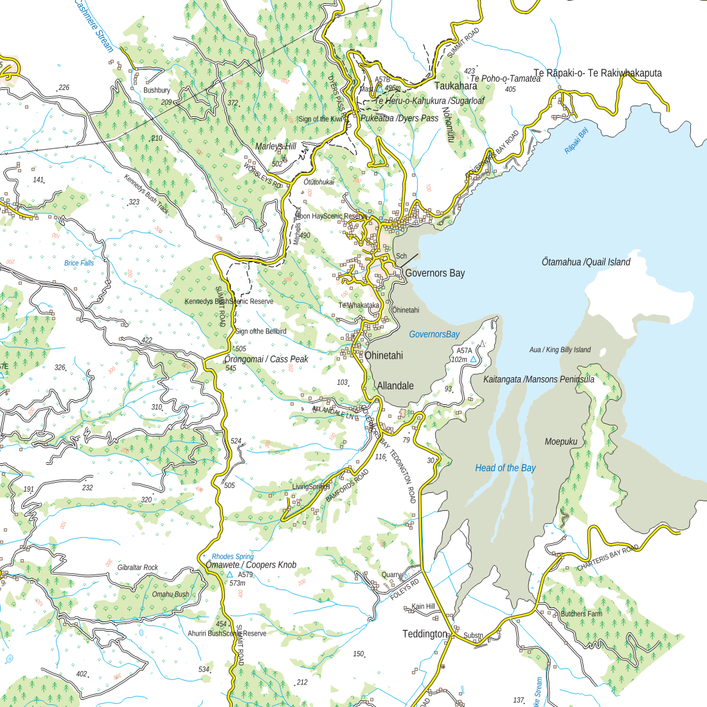

# os50-topo-styles

A QGIS style that gives **LINZ NZ Topo50** data (GeoParquet from the NZTopo50 QGIS plugin /
[LINZ topographic-system](https://github.com/linz/topographic-system)) the look of an
**Ordnance Survey 1:50 000** (Landranger) raster map.



The colours and line widths were read directly from the vector drawings in the OS
**1:50 000 raster legend PDF (version 2022-01)**. Its widths are in points and are converted to
mm here (1 pt = 0.3528 mm). No OS artwork is included.

## Roads: NZ class → OS class

| NZ Topo50 | OS class | Colour | Casing / fill |
|---|---|---|---|
| State highway, 4+ lanes | Motorway | #00AEEF | 3.78 / 2.10 pt |
| State highway | Primary route | #00A650 | 2.27 / 1.42 pt |
| Sealed, 2+ lanes | Road generally more than 4 m wide | #FFF200 | 2.27 / 1.42 pt |
| Sealed, 1 lane | Road generally less than 4 m wide | #FFF200 | 1.70 / 0.85 pt |
| Metalled / unmetalled / vehicle track | Other road, drive or track | white | 1.70 / 0.85 pt |
| Foot track | Path | black | 0.56 pt, dash 4.2 / 1.4 pt |
| Under construction | Road under construction | #EC008C dashes | 2.27 / 1.42 pt |

OS magenta (A road) and orange (B road, #FAA21A) have no equivalent in the LINZ data.

## Other OS conventions

| Element | OS value |
|---|---|
| Railway (single / multiple) | black 1.134 pt; sidings 0.567 pt; light rail ticked; tunnels dashed |
| Station | magenta #EC008C dot |
| Contours | #F69679, 0.28 pt; index 0.56 pt (every 100 m here) |
| Water | lines #00AEEF (streams 0.43 pt), fill #D4EFFC; black high-water line |
| Woods | #DBEAB9 with green #00A650 conifer / broadleaf symbols; NZ native bush becomes non-coniferous wood |
| Orchard / park | #FFFDEA with green dots / #E6E7E8 |
| Buildings | #FEDCC2 with black 0.28 pt outline |
| Sand / mud / shingle / marsh | #FFEBCA + dots / #D8DDC9 / dots / blue tufts |
| Triangulation pillar | cyan triangle |
| Power line / pipe line | 0.425 pt line with pylon marks / dashed with flow arrows |
| Paper | white, no hill shading |

## Typography

The OS legend embeds **OS Univers**, OS Gill Sans and Source Sans Pro. OS Univers is OS's own
typeface and can't be bought, so the style uses **Source Sans Pro** (free, Google Fonts):
black for names, darker blue italic for water names, no halo. If you have Univers installed, change
`Family` in `scripts/mapping_os50.py`.

## Use

Copy `projects/nztopo50_os50_style.qgs` **and the `os50_symbol/` folder** into an NZTopo50 plugin
download folder, next to `nztopo50.qgs`. It reads `./data/*.parquet` and
`./data/extras/*.parquet`, and reuses LINZ's `./symbol/*.svg`.

To rebuild, run:

```bash
MAPPING=mapping_os50 python scripts/build.py <template.qgs> <download>/nztopo50.qgs \
    <download>/nztopo50_os50_style.qgs <download>/os50_mapping.csv
```

`build.py` and `stylekit.py` are shared with
[swiss-topo-styles](https://github.com/MutantKiwi/swiss-topo-styles) and
[nzms1-topo-styles](https://github.com/MutantKiwi/nzms1-topo-styles). The first argument is a
QGIS project used only as a source of symbol-layer templates; the swisstopo
`SMV25_CHLV95LN02.qgs` is what it was written against.

## Known limitations

* Motorway is approximated as "state highway with 4+ lanes".
* Rights of way, national trails, cycle routes, access land, tourist symbols, place-name
  abbreviations and boundaries are not in the LINZ data.
* Topo50 contours are 20 m; OS uses 10 m.
* LINZ highway shields are kept. OS prints road numbers as coloured text.

## Credits

* Symbol specification after the Ordnance Survey 1:50 000 raster legend (© Crown copyright,
  Ordnance Survey). This project is not affiliated with or endorsed by Ordnance Survey.
* NZ data: LINZ NZ Topo50, CC BY 4.0. LINZ symbol SVGs are reused from the NZTopo50 download.
